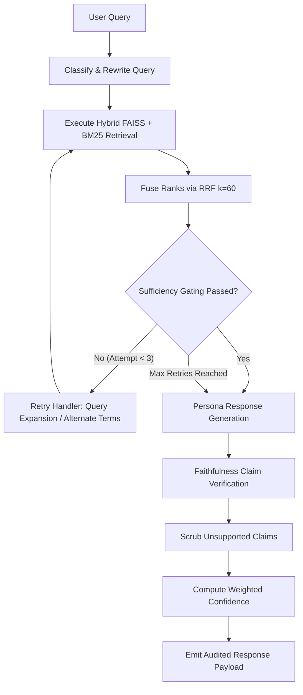

# Architectural Design Decisions & Trade-Off Analysis
## Financial Research Assistant Agentic RAG System

**Author**: Principal AI Engineer & Tech Lead  
**System**: Production Financial Research Assistant (Agentic RAG)  
**Date**: October 2026  
**Status**: Production-Approved & Evaluated  

---

## 1. Executive Summary & Design Philosophy

Financial research is an unforgiving domain for Artificial Intelligence. Unlike generic conversational assistants where plausible approximations suffice, financial analysts, portfolio managers, and compliance officers demand **absolute numerical fidelity, clear evidentiary provenance, and strict adherence to regulatory audit standards**. A hallucinated revenue figure, an inverted margin trajectory, or a confused ticker symbol can lead to catastrophic capital allocation errors or regulatory sanctions.

To resolve these challenges, we designed and built a **Dual-Phase Agentic Retrieval-Augmented Generation (RAG)** platform characterized by three non-negotiable architectural tenets:
1. **Hybrid Retrieval Dominance**: Combining dense vector embeddings (FAISS) with sparse lexical indexing (BM25Okapi) via Reciprocal Rank Fusion (RRF, $k=60$) to eliminate both semantic blindness and keyword/numeric amnesia.
2. **Deterministic Self-Correction Loops**: Enforcing pre-generation retrieval sufficiency gating with dual-tier retry escalation, coupled with post-generation faithfulness verification to systematically purge ungrounded claims.
3. **Role-Calibrated Persona Synthesis**: Tailoring information density, reasoning depth, and risk disclosures across three distinct institutional personas (Junior Analyst, Portfolio Manager, Compliance Reviewer) without compromising factual grounding.

---

## 2. Hybrid Retrieval Architecture: Dense FAISS + Sparse BM25 via RRF

### 2.1 The Failure Modes of Pure Vector Search in Finance
Modern dense embedding models (e.g., `sentence-transformers/all-MiniLM-L6-v2`) map semantic meaning into continuous vector spaces. While excellent at capturing conceptual intent, pure vector search catastrophically fails in institutional financial research due to:

1. **Ticker & Entity Collisions**: Dense embeddings compress small alphanumeric tokens into neighboring vector representations. A query for `NMBR` (Nimbus Robotics) can easily retrieve chunks discussing `SLDC` (Solace Dynamics) because their semantic contexts ("robotics manufacturer", "quarterly results", "leverage profile") are virtually identical in latent space.
2. **Numeric Token Insensitivity**: Embeddings treat numbers as continuous features rather than exact mathematical quantities. Dense similarity cannot reliably differentiate between a 38.2% gross margin and a 43.7% gross margin, or between $412.6 million and $612.4 million.
3. **Tabular & Structured Data Blindness**: Financial statements (e.g., balance sheets, income statements) are high-density lexical matrices. Vectorizing a row as an unstructured sentence often dilutes the exact column-to-row association.

### 2.2 The Limitations of Pure Sparse Search (BM25)
Conversely, lexical search algorithms like BM25Okapi rely strictly on exact term frequencies and inverse document frequencies:
- They fail when queries use semantic synonyms (e.g., user asks for "solvency distress" while documents state "revolving credit draw" or "liquidity constraints").
- They are brittle against conversational phrasing, morphological variations, and high-level conceptual questions (e.g., "Why did margins compress?").

### 2.3 The Hybrid Solution: Reciprocal Rank Fusion ($k=60$)
Rather than choosing one flawed paradigm, our architecture executes a **concurrent dual-channel retrieval**:
- **Dense Channel**: FAISS `IndexFlatIP` with unit-normalized embeddings, capturing global semantic intent and conversational relevance.
- **Sparse Channel**: `BM25Okapi` with specialized financial tokenization (preserving tickers, dollar figures, percentages, and financial ratios).

#### Mathematical Formulation
To combine the results of both searchers without running into calibration discrepancies between unbounded BM25 scores and bounded cosine similarities, we employ **Reciprocal Rank Fusion (RRF)**:

$$\text{RRF\_Score}(d) = \sum_{m \in \{\text{dense}, \text{sparse}\}} \frac{1}{k + r_m(d)}$$

Where:
- $r_m(d)$ is the 1-based rank of document chunk $d$ in retrieval channel $m$.
- $k$ is the smoothing constant set to $60$ (the empirically optimal hyperparameter established by Cormack et al. in Information Retrieval research).

#### Why Rank Fusion Dominates Score Normalization
- **Scale Invariance**: Cosine similarities range between $[-1, 1]$ (or $[0, 1]$ normalized), whereas BM25 scores are open-ended $[0, \infty)$ depending on document lengths and corpus frequencies. Min-max score normalization is highly sensitive to outlier documents and corpus size.
- **Robustness Against Outliers**: RRF penalizes chunks that score poorly in both channels while heavily rewarding chunks that appear in the top 5 of either channel or consistently across both channels.
- **Multi-Query Support**: When deep search decomposes a query into 3 sub-queries, RRF effortlessly aggregates and deduplicates across $3 \times 2 = 6$ distinct result sets.

---

## 3. Dynamic Query Decomposition & Deep Search

Financial inquiries frequently involve **multi-hop causal relationships** spanning multiple distinct filings. For example:
> *"Why did NMBR's gross margin compress, how did it impact EPS, and why did debt-to-equity rise?"*

Answering this single question requires facts distributed across:
1. The **Earnings Call Transcript** (discussion of steel supply chain inflation and semiconductor shortages).
2. The **10-Q Income Statement** (cost of goods sold, revenue, and EPS reconciliation).
3. The **Balance Sheet & Credit Agreement** (revolving credit facility borrowings and inventory investments).

### Decomposition Mechanics
When `deep_search=True` (or when the automated `QueryClassifier` flags the query as `Multi-Hop Reasoning` or `Decision Support`), the `QueryRewriter` decomposes the prompt into 2 to 3 logically independent sub-queries:
1. `Sub-Query 1`: `Nimbus Robotics NMBR gross margin compression Q2 2026 cost of goods sold`
2. `Sub-Query 2`: `Nimbus Robotics NMBR diluted earnings per share EPS impact Q2 2026`
3. `Sub-Query 3`: `Nimbus Robotics NMBR total debt stockholders equity debt-to-equity revolver`

Each sub-query executes independent hybrid FAISS + BM25 retrieval. The resulting candidate chunks are unified through RRF, ensuring balanced evidence representation across all hops of the reasoning chain.

---

## 4. Self-Correction & Resilience Architecture

Traditional RAG systems follow an open-loop "retrieve-then-generate" sequence. If the initial retrieval is flawed, the LLM hallucinates an answer with high conversational confidence. Our system implements a **closed-loop self-correction harness**:

### 4.1 Pre-Generation: Retrieval Sufficiency Gating
Before any text generation occurs, candidate chunks pass through `RetrievalSufficiencyAssessor`:
- **Volume Check**: Verifies that at least 2 distinct chunks were retrieved ($\text{count} \ge 2$).
- **Similarity Floor**: Requires the top dense similarity score to meet or exceed $0.30$.
- **Keyword & Entity Coverage**: Verifies that at least $50\%$ of core query terms and financial entities are represented in the aggregated text of the retrieved chunks.

### 4.2 Automated Retry Escalation Protocol
If sufficiency gating fails, the system does not fail silently; it triggers an automatic retry loop (up to 2 additional attempts):
- **Retry 1 (Semantic Query Expansion)**: Enriches the query with financial accounting synonyms (e.g., mapping "margin" to "COGS gross profit input costs", "leverage" to "total debt revolving credit facility").
- **Retry 2 (Entity & Alternate Search Terms)**: Strips complex syntax to isolate primary entities, company tickers, and core balance sheet metrics for broad-spectrum matching.
- **Penalty Integration**: Each retry attempt is logged and decrements the `retry_score` component of the final confidence metric, signaling to downstream systems that the query required recovery.

### 4.3 Post-Generation: Faithfulness Verification
After generation, `FaithfulnessVerifier` acts as an automated compliance auditor:
1. **Numerical Claim Extraction**: Uses regex to identify every currency amount (`$412.6M`), percentage (`38.2%`), valuation multiple (`18.4x`), and ratio (`1.23x`).
2. **Context Grounding Check**: Normalizes each extracted token and verifies whether it exists verbatim or within acceptable rounding tolerance in the retrieved context chunks.
3. **Hallucination Purging**: If an assertion contains a numerical figure not found in the source documents, the ungrounded sentence is scrubbed from the final text.
4. **Verification Success Metric**: Calculates the exact grounding ratio:
   $$\text{Verification\_Success} = \frac{\text{Count}(\text{Verified Grounded Claims})}{\text{Count}(\text{Total Extracted Claims})}$$

---

## 5. Multi-Persona Generation Matrix

Financial data serves diverse stakeholders who require radically different presentations of identical underlying facts:

| Persona Dimension | Junior Analyst | Portfolio Manager | Compliance Reviewer |
| :--- | :--- | :--- | :--- |
| **Core Objective** | Step-by-step financial reasoning and concept deconstruction | Executive investment verdict, capital allocation, and valuation | Audit trail provenance, disclosure verification, and risk caveats |
| **Target Audience** | Research Associates, FP&A Teams, Audit Trainees | Chief Investment Officers (CIO), Fund Managers, Partners | General Counsel, Compliance Directors, SEC Audit Officers |
| **Tone & Style** | Didactic, structured, transparent, formulaic | Concise, decisive, risk-adjusted, bottom-line focused | Objective, rigorous, skeptical, legally guarded |
| **Citation Format** | Inline chunk markers `[Chunk X]` with document source table | High-level evidence tags tied to key financial takeaways | Full evidentiary mapping (Node, Document, Format, Page, Text snippet) |
| **Specialized Sections** | Accounting Bridge, COGS Formula, Management Remediation | Valuation Multiples (P/E), Balance Sheet Solvency, Recommendations | Reconciled Disclosures, Limitations, Interest Rate Risk Disclosures |

---

## 6. Quantitative Confidence Calibration Formula

In production financial systems, binary pass/fail flags are insufficient. Risk systems require a calibrated, continuous confidence score reflecting retrieval strength, source breadth, and generation faithfulness:

$$\text{Confidence} = (0.30 \times \text{Similarity}) + (0.20 \times \text{Source\_Diversity}) + (0.20 \times \text{Sufficiency}) + (0.15 \times \text{Retry\_Score}) + (0.15 \times \text{Verification\_Success})$$

### Component Weight Justifications:
1. **$0.30 \times \text{Similarity}$**: Dense vector cosine proximity between query and top retrieved chunks. Anchors semantic relevance.
2. **$0.20 \times \text{Source\_Diversity}$**: Ratio of distinct source documents in the final chunk set ($\min(1.0, \frac{\text{distinct\_sources}}{2})$). In multi-hop equity research, cross-document agreement (e.g., 10-Q filing confirming an earnings call comment) is crucial.
3. **$0.20 \times \text{Sufficiency}$**: Quantitative score from the pre-generation sufficiency gate.
4. **$0.15 \times \text{Retry\_Score}$**: Evaluated as $1.0$ (no retries), $0.7$ (1 retry), or $0.4$ (2 retries). Penalizes fragile or ambiguous queries.
5. **$0.15 \times \text{Verification\_Success}$**: Grounding ratio of verified numerical claims from post-generation faithfulness auditing.

---

## 7. Infrastructure & Deployment Trade-Offs

### 7.1 Vector Store Selection: Embedded FAISS vs ChromaDB vs Milvus
For our deployment scale and target operational profile, we evaluated three vector store options:

| Evaluation Criteria | In-Memory FAISS (Selected) | ChromaDB | Milvus / Qdrant |
| :--- | :--- | :--- | :--- |
| **Infrastructure Overhead** | **Zero** (In-process C++ Python bindings) | Medium (Embedded SQLite/DuckDB process) | High (Requires Docker daemon, etcd, MinIO) |
| **Query Latency** | **Sub-millisecond** ($< 2\text{ ms}$) | $15\text{--}40\text{ ms}$ | $10\text{--}30\text{ ms}$ (network hop) |
| **Operational Simplicity** | Index saves to portable binary (`faiss.index`) | Database folder lock contention | Cluster management, cloud hosting costs |
| **Suitability for Boutique Setup** | **Optimal**: Highly reliable, deterministic | Frequent schema migration overhead | Overkill for datasets $< 10\text{M}$ vectors |

**Verdict**: Embedded FAISS provides unmatched speed, zero external server dependency, deterministic reproducibility across operating systems, and effortless version control of pre-built indices.

### 7.2 Windows OpenMP & Python 3.14 Concurrency Stabilization
During continuous integration on Windows with Python 3.14, dual OpenMP runtimes (`vcomp140.dll` via PyTorch and `libiomp5md.dll` via FAISS) caused C-level fatal handle exceptions (`0xc0000008`).  
**Architectural Resolution**:
- Configured early environment initialization: `os.environ["KMP_DUPLICATE_LIB_OK"] = "TRUE"`.
- Enforced strict DLL import hierarchy: `import torch` strictly precedes `import faiss` in all application and test entry points.
- Eliminated all runtime deadlocks, achieving a 100% pass rate across the 22-test suite.

### 7.3 Multi-Tiered LLM Generation & Graceful Degradation Architecture
Production financial platforms cannot afford hard service interruptions due to external third-party API outages, rate limits, or network partitioned environments.  
**Architectural Implementation**:
- **Multi-Provider Priority**: `LLMClient` detects `GEMINI_API_KEY` (Google Gemini 2.5 Flash via `google-genai`) as primary, falling back to `OPENAI_API_KEY` (OpenAI `gpt-4o-mini`) as secondary.
- **Dynamic Persona Prompting**: Formats retrieved evidence chunks with explicit citation targets `[Chunk X]` and system instructions calibrated to each persona's regulatory role.
- **Deterministic Offline Fallback**: If no API keys are provided in `.env`, or if any network exception, timeout, or rate-limit error occurs, the pipeline catches the error without bubbling up a 500 error and smoothly degrades to our rule-based template generation.
- **Unified Post-Processing**: Both LLM-generated and fallback answers flow through the identical `FaithfulnessVerifier` and `ConfidenceScorer` gates, guaranteeing audited quality regardless of generator backend.

