# Financial Research Assistant Agentic RAG Platform

[](https://www.python.org/)
[](https://fastapi.tiangolo.com/)
[](https://github.com/facebookresearch/faiss)
[]()
[]()

A production-grade, dual-phase **Agentic Retrieval-Augmented Generation (RAG)** platform designed for institutional financial research, multi-document equity analysis, accounting forensics, and regulatory audit compliance.

---

## 1. System Architecture & Workflow

The platform follows an audited, dual-phase pipeline designed for deterministic execution, high-recall hybrid retrieval, and grounded multi-persona synthesis.

```mermaid
flowchart TD
    subgraph Phase_A ["Phase A: Document Ingestion Pipeline"]
        A1["Heterogeneous Source Files\n(PDF, DOCX, TXT, CSV/XLSX)"] --> A2["Format-Specific Loaders\n(pypdf, python-docx, tabular)"]
        A2 --> A3["RecursiveCharacterTextSplitter\n(chunk_size=500, chunk_overlap=50)"]
        A3 --> A4["Metadata Extraction & Tagging\n(doc_name, type, page_num, chunk_id)"]
        A4 --> A5["Dense Embeddings\nsentence-transformers/all-MiniLM-L6-v2"]
        A4 --> A6["Sparse Tokenization\nFinancial BM25Okapi"]
        A5 --> A7[("FAISS Dense Index\nIndexFlatIP (Cosine)")]
        A6 --> A8[("BM25 Sparse Inverted Index")]
    end

    subgraph Phase_B ["Phase B: Query & Retrieval Pipeline (POST /finance-agent)"]
        B1["Incoming Request Contract\n(session_id, query, persona, deep_search)"] --> B2["Query Understanding & Intent Classification\n(Fact, Comparison, Multi-Hop, Decision)"]
        B2 --> B3["Query Rewriting & Acronym Expansion"]
        B3 --> B4{"Deep Search or\nMulti-Hop/Decision?"}
        B4 -- Yes --> B5["Decompose into 2-3 Logical Sub-Queries"]
        B4 -- No --> B6["Direct Semantic Query"]
        B5 --> B7["Hybrid Retrieval\nDense FAISS + Sparse BM25"]
        B6 --> B7
        B7 --> B8["Reciprocal Rank Fusion (RRF, k=60)\nCross-Query Deduplication"]
        B8 --> B9{"Sufficiency Assessment\n(Volume >= 2, Similarity >= 0.30, Coverage >= 50%)"}
        B9 -- Failed (Attempts < 3) --> B10["Automatic Retry Escalation\n(Retry 1: Expansion | Retry 2: Alternates)"]
        B10 --> B7
        B9 -- Passed / Max Retries --> B11["Persona Response Generation\n(Junior Analyst | PM | Compliance)"]
        B11 --> B12["Post-Generation Faithfulness Verification\n(Numerical Claim Extraction & Scrubbing)"]
        B12 --> B13["Weighted Confidence Scoring\n(Similarity, Diversity, Sufficiency, Retries, Faithfulness)"]
        B13 --> B14["Audited Structured JSON Payload"]
    end
```



---

## 2. Setup & Execution Guide

### 2.1 Prerequisites & Installation
Ensure Python 3.10+ (tested on Python 3.14 on Windows) is installed. Clone the repository and install dependencies:

```powershell
pip install -r requirements.txt
```

*Key Dependencies*: `fastapi`, `uvicorn`, `faiss-cpu`, `sentence-transformers`, `torch`, `rank-bm25`, `pypdf`, `python-docx`, `pandas`, `pytest`.

### 2.2 Environment Configuration (.env) & LLM Setup
The system supports real LLM generation via **Google Gemini** (primary) and **OpenAI** (secondary) using `python-dotenv`:

Create or edit your `.env` file in the project root:
```env
# Primary LLM Provider
GEMINI_API_KEY=your_gemini_api_key_here
GEMINI_MODEL=gemini-2.5-flash

# Secondary / Fallback LLM Provider
OPENAI_API_KEY=your_openai_api_key_here
OPENAI_MODEL=gpt-4o-mini

# Timeout (seconds)
LLM_TIMEOUT_SECONDS=20
```

> [!NOTE]
> **Clean Zero-Failure Fallback**: If no API key is provided, or if network connectivity is unavailable, or if rate limits are reached, the system **automatically and gracefully falls back** to its audited, deterministic template synthesis. The entire platform operates 100% offline without requiring external API keys.

### 2.3 Ingest Documents & Build Hybrid Indices
Ingest heterogeneous files from `./data` (PDFs, DOCX notes, 10-Q excerpts, transcripts, and financial CSV tables):

```powershell
python main.py --ingest
```
*Output*: 53 document chunks indexed into `storage/indices/faiss.index`, `storage/indices/bm25.pkl`, and `storage/indices/chunks.json`.

### 2.3 Launch FastAPI Server & Web Dashboard
Start the production server:

```powershell
# Start server on http://127.0.0.1:8000 and automatically open web browser
python main.py --server --browser
```

Accessible interfaces:
- **Interactive Web Dashboard**: [http://127.0.0.1:8000/](http://127.0.0.1:8000/)
- **Swagger OpenAPI Docs**: [http://127.0.0.1:8000/docs](http://127.0.0.1:8000/docs)
- **ReDoc Interactive Reference**: [http://127.0.0.1:8000/redoc](http://127.0.0.1:8000/redoc)
- **Health Check**: [http://127.0.0.1:8000/health](http://127.0.0.1:8000/health)

### 2.5 Execute Full Test Suite
Run the comprehensive 22-test automated test suite:

```powershell
python -m pytest tests/ -v
```

---

## 3. API Endpoint Specification (`POST /finance-agent`)

### Request Contract
```http
POST /finance-agent HTTP/1.1
Host: 127.0.0.1:8000
Content-Type: application/json

{
  "session_id": "client_session_001",
  "query": "How did rising input costs affect gross margin, and how did that influence quarterly earnings per share?",
  "persona": "Junior Analyst",
  "deep_search": true
}
```

### Response Contract
```json
{
  "session_id": "client_session_001",
  "query_type": "Multi-Hop Reasoning",
  "original_query": "How did rising input costs affect gross margin, and how did that influence quarterly earnings per share?",
  "rewritten_query": "How did rising input costs affect gross margin, and how did that influence quarterly earnings per share",
  "deep_search_used": true,
  "retrieval_attempts": 1,
  "retrieval_sufficient": true,
  "confidence_score": 0.80,
  "used_chunks": [
    "chunk_41",
    "chunk_37",
    "chunk_46",
    "chunk_38"
  ],
  "answer": "### Financial Research Analysis: How Did Rising Input Costs Affect Gross Margin...\n\n**Persona Perspective**: Junior Analyst — Step-by-Step Financial Reasoning & Accounting Deconstruction.\n\n#### 1. Core Financial Findings & Direct Evidence\n- **Evidence [Chunk 41]** (`NMBR_Q2_2026_Earnings_Call_Transcript.txt`, Page 1): Gross margin contracted to 38.2%...\n- **Evidence [Chunk 37]** (`Nimbus_Robotics_10Q_Q2_2026.pdf`, Page 1): Condensed Consolidated Statements of Operations...\n\n#### 2. Step-by-Step Financial Concepts & Accounting Mechanics\n- **Step 1 (Revenue & Top-Line Performance)**: Net revenue reached $412.6 million (+9.4% YoY) [Chunk 41]...\n- **Step 2 (Cost Structure & Margin Compression)**: Gross margin dropped from 43.7% to 38.2% due to a 21% surge in steel and semiconductor costs...\n- **Step 3 (Earnings Flow-Through & EPS Breakdown)**: Diluted EPS dropped from $0.89 to $0.61 (-$0.28 YoY), where ~$0.19 was margin compression and $0.09 from interest expense and R&D...\n\n#### 3. Management Remediation Actions\n- **Supplier Diversification**: Qualified an alternate semiconductor supplier in Southeast Asia [Chunk 41]...\n\n#### 4. Source Chunk Citations\n- **[Chunk 41]**: `NMBR_Q2_2026_Earnings_Call_Transcript.txt` (Page 1, Type: txt)\n- **[Chunk 37]**: `Nimbus_Robotics_10Q_Q2_2026.pdf` (Page 1, Type: pdf)"
}
```

---

## 4. Persona Behavior Matrix

| Dimension | 👨‍💼 Junior Analyst | 📈 Portfolio Manager | ⚖️ Compliance Reviewer |
| :--- | :--- | :--- | :--- |
| **Target Role** | Research Associate / FP&A Analyst | Chief Investment Officer / Fund Manager | Compliance Director / SEC Audit Officer |
| **Tone & Style** | Didactic, transparent, pedagogical | High-level, decisive, risk-adjusted | Rigorous, objective, audit-focused |
| **Primary Focus** | Accounting mechanics, COGS flow-through, financial formulas | Valuation multiples, capital allocation, downside solvency | Evidentiary audit trails, reconciliation, limitations & caveats |
| **Citation Style** | Explicit inline markers `[Chunk X]` with summary citation section | Contextual evidence tags tied to investment conclusions | Node-by-node mapping with file format, page, and excerpt text |
| **Mandatory Sections** | Step-by-Step Concepts, Accounting Bridge, Citations | Executive Verdict, Valuation Multiples, Balance Sheet Solvency | Evidentiary Audit Trail, Disclosures, Material Limitations |

---

## 5. Mathematical Formulation: Weighted Confidence Scoring

Every query is quantitatively evaluated across 5 dimensions to produce a calibrated confidence score between `0.0` and `1.0`:

$$\text{Confidence} = (0.30 \times S_{\text{sim}}) + (0.20 \times D_{\text{src}}) + (0.20 \times C_{\text{suff}}) + (0.15 \times R_{\text{retry}}) + (0.15 \times V_{\text{faith}})$$

### Component Breakdown & Calibration Rationale

| Term | Weight | Formula / Range | Calibration Rationale |
| :--- | :---: | :--- | :--- |
| **$S_{\text{sim}}$** (Similarity) | **30%** | $\max_{c \in \text{chunks}} \text{CosineSim}(q, c) \in [0.0, 1.0]$ | Quantifies peak semantic alignment between user query and best retrieved context. |
| **$D_{\text{src}}$** (Source Diversity) | **20%** | $\min\left(1.0, \frac{\text{distinct documents in chunks}}{2}\right)$ | Rewards cross-filing corroboration (e.g., verifying earnings call statements against SEC 10-Q figures). |
| **$C_{\text{suff}}$** (Sufficiency) | **20%** | $[0.0, 1.0]$ from `RetrievalSufficiencyAssessor` | Validates chunk volume ($\ge 2$), similarity floor ($\ge 0.30$), and query entity coverage ($\ge 50\%$). |
| **$R_{\text{retry}}$** (Retry Score) | **15%** | $\begin{cases} 1.0 & \text{attempts}=1 \\ 0.7 & \text{attempts}=2 \\ 0.4 & \text{attempts}=3 \end{cases}$ | Penalizes ambiguous or low-recall queries that required automated retry recovery. |
| **$V_{\text{faith}}$** (Verification Success) | **15%** | $\frac{\text{Verified Grounded Claims}}{\text{Total Extracted Claims}} \in [0.0, 1.0]$ | Post-generation audit measuring percentage of generated numerical claims confirmed by retrieved chunks. |

---

## 6. Official Evaluation Benchmark Suite

The system includes an automated evaluation benchmark runner [`run_benchmark.py`](file:///c:/Users/seril/Documents/Financial/Financial/run_benchmark.py) that tests the live API against all 7 official evaluation queries.

### Execute Benchmark Suite
```powershell
python run_benchmark.py
```

### Benchmark Results Summary (`benchmark_results.json`)

| ID | Category | Target Persona | Deep Search | Classification | Attempts | Sufficiency | Confidence | Latency | Status |
| :---: | :--- | :--- | :---: | :--- | :---: | :---: | :---: | :---: | :---: |
| **Q1** | Multi-Hop / Fact Retrieval | Junior Analyst | True | Multi-Hop Reasoning | 1 | **Passed** | **0.80** | 0.15s | **PASS** |
| **Q2** | Comparison / Balance Sheet | Portfolio Manager | True | Comparison | 3 | Handled | **0.60** | 0.26s | **PASS** |
| **Q3** | Valuation & Growth Trade-off | Portfolio Manager | False | Fact Retrieval | 1 | **Passed** | **0.80** | 0.03s | **PASS** |
| **Q4** | Grounding & Verification | Compliance Reviewer | False | Decision Support | 3 | Handled | **0.68** | 0.19s | **PASS** |
| **Q5** | System Resilience | Junior Analyst | False | Decision Support | 3 | Handled | **0.71** | 0.19s | **PASS** |
| **Q6** | Verification Architecture | Compliance Reviewer | False | Comparison | 3 | Handled | **0.42** | 0.13s | **PASS** |
| **Q7** | Infrastructure Trade-offs | Portfolio Manager | False | Decision Support | 3 | Handled | **0.56** | 0.21s | **PASS** |

- **Total Benchmark Pass Rate**: **100% (7/7 valid JSON schema contracts)**
- **Average Query Latency**: **0.16 seconds**
- **Persisted Artifact**: [`benchmark_results.json`](file:///c:/Users/seril/Documents/Financial/Financial/benchmark_results.json)

For detailed architectural justifications and trade-off analyses, refer to [`DESIGN_DECISIONS.md`](file:///c:/Users/seril/Documents/Financial/Financial/DESIGN_DECISIONS.md).
